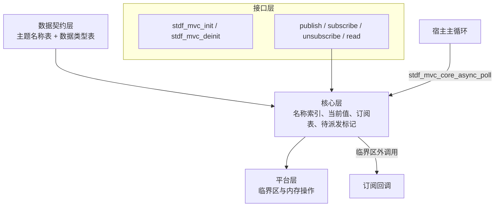

# STDF MVC 发布订阅框架

> 基于主题的数据发布订阅机制，为模块之间提供统一的数据交换通道。

## 1 简介

STDF MVC 是 C11 实现的发布订阅框架，用于模块之间的数据共享。

框架提供两类参与者：发布方将数据提交到指定主题，订阅方按主题登记回调。发布方不感知订阅方的存在，订阅方不感知数据的来源，双方只依赖同一个主题标识和该主题对应的数据结构。

框架为每个主题保存最近一次发布的值，订阅方既可以通过回调接收变更通知，也可以直接读取当前值。

数据交付语义为最新值同步：同一主题在派发前连续发布多次时，只保留最后一次，旧值被覆盖。框架适用于状态共享场景，不提供逐条可靠交付。

### 核心概念

| 概念 | 说明 |
| :--- | :--- |
| 主题（subject） | 一类数据的唯一标识，同时绑定该主题的数据结构类型 |
| 发布（publish） | 向主题提交一份数据，更新其当前值 |
| 订阅（subscribe） | 为主题登记回调，在派发时接收更新 |
| 读取（read） | 直接获取主题最近一次发布的值 |
| 派发（poll） | 由宿主主循环调用，将待处理更新提交给订阅回调 |

### 接口概览

```c
/* 订阅方登记回调 */
stdf_mvc_api_subscribe(STDF_MVC_ANY, STDF_MVC_SUBJECT_DM_TEMPERATURE, on_temperature);

/* 发布方提交数据 */
stdf_mvc_api_publish(STDF_MVC_LOCAL, STDF_MVC_SUBJECT_DM_TEMPERATURE,
                     &temperature, STDF_MVC_PUB_ASYNC);

/* 宿主主循环驱动派发 */
stdf_mvc_core_async_poll();
```

上述三段代码之间没有直接调用关系，仅通过主题标识关联。

## 2 方案优势

### 2.1 方案概述

框架把一次数据交换拆分为三个独立环节：

| 环节 | 执行时机 | 责任 |
| :--- | :--- | :--- |
| 数据契约 | 编译期 | 在注册表中声明主题名称与数据类型 |
| 数据提交 | 调用发布接口时 | 复制数据、更新当前值、标记待派发 |
| 变更通知 | 宿主调用 poll 时 | 取出待派发数据、匹配订阅者、执行回调 |

发布与派发分离意味着回调的执行上下文由宿主决定，框架不创建线程，不参与调度策略。

### 2.2 旧方案痛点

以下为模块间共享状态时的常见做法及其需要额外处理的问题。

| 常见做法 | 需要额外处理的问题 |
| :--- | :--- |
| 生产方直接调用消费方 | 生产方需要维护消费方列表，新增消费方需修改生产方 |
| 跨模块共享全局变量 | 数据归属、访问权限、加锁策略和变更通知分散在各模块 |
| 按条入队的消息队列 | 状态类更新持续堆积，需定义队列满时的处理策略，并可能持续消费过时数据 |
| 手工传递字节缓冲区 | 数据类型与长度依靠约定维护，结构体变更后需逐一核对 |

### 2.3 此方案优势

| 设计 | 作用 |
| :--- | :--- |
| 按主题发布订阅 | 数据契约与模块实现分离，消费方的增减不影响生产方 |
| 保存最新值 | 同时支持变更通知与主动查询，订阅方无需维护数据副本 |
| 待派发值覆盖 | 派发前连续发布只保留最后一次，避免处理过时状态 |
| 编译期确定存储 | 缓存、待派发存储和订阅表按注册类型静态分配，运行时无动态内存 |
| 宿主驱动派发 | 回调执行位置与频率由宿主控制，便于接入既有事件循环 |
| 长度由类型决定 | 调用方不传递字节长度，框架按注册类型大小复制 |

对需要逐条确认、重试或持久化的消息，应选择具备相应交付保证的机制。

## 3 软件框架

框架分为数据契约层、接口层、核心层和平台层，依赖关系单向。



| 路径 | 职责 |
| :--- | :--- |
| `mvc/stdf_mvc.h` | 框架初始化与反初始化 |
| `mvc/stdf_mvc_api.h` | 发布、订阅、退订、读取接口 |
| `mvc/subsystem/stdf_mvc_subsystem.h` | 汇总各模块的主题表与类型表 |
| `mvc/subsystem/<module>/` | 模块级主题名称与数据结构定义 |
| `mvc/core/stdf_mvc_core_subject.*` | 主题枚举与名称查询 |
| `mvc/core/stdf_mvc_core_value.*` | 主题当前值存储 |
| `mvc/core/stdf_mvc_core_async.*` | 订阅表、待派发标记、快照与派发 |
| `mvc/core/stdf_mvc_core_port*` | 平台临界区与内存操作抽象 |
| `mvc/config/stdf_mvc_core_config.h` | 编译期配置 |
| `mvc/util/stdf_mvc_log.h` | 日志输出 |

业务代码依赖接口层与数据契约层；接口层调用核心层；核心层通过平台层访问临界区，不依赖任何业务模块。宿主负责框架生命周期和 poll 的调用节奏。

## 4 详细设计

### 4.1 数据契约

主题由名称与数据类型两部分定义，分别登记在两张 X-Macro 清单中。

| 清单 | 条目格式 | 核心据此生成 |
| :--- | :--- | :--- |
| `STDF_MVC_<MODULE>_SUBJECT_LIST(X)` | `X(subject_id, "module.name")` | 主题枚举值、名称索引数组 |
| `STDF_MVC_<MODULE>_DATA_LIST(X)` | `X(subject_id, payload_type)` | 类型化存储、大小索引、订阅者数组 |

DM 模块的现有定义：

```c
#define STDF_MVC_DM_SUBJECT_LIST(X) \
    X(STDF_MVC_SUBJECT_DM_TEMPERATURE, "dm.temperature") \
    X(STDF_MVC_SUBJECT_DM_HUMIDITY, "dm.humidity")

#define STDF_MVC_DM_DATA_LIST(X) \
    X(STDF_MVC_SUBJECT_DM_TEMPERATURE, stdf_mvc_dm_temperature_t)
```

聚合头 `stdf_mvc_subsystem.h` 将各模块清单拼接为 `STDF_MVC_SUBJECT_LIST(X)` 与 `STDF_MVC_DATA_LIST(X)`。清单本身不含逻辑，核心通过不同的宏多次展开同一份清单以生成不同类型的定义。

注册状态决定主题能力：

| 注册情况 | 可用能力 |
| :--- | :--- |
| 名称表与类型表均已登记 | 发布、订阅、读取均可用 |
| 仅登记名称表 | 可查询名称与编号，不具备存储空间，发布与订阅被拒绝 |

主题编号由枚举顺序决定，按模块分段：DM 起始于 1，NET 起始于 100，CAMERA 起始于 200，UI 起始于 300，段内顺序递增。
新增条目应追加到所属模块清单末尾；插入中间位置会改变后续主题的编号，模块增长不得越过下一模块的起始编号。

### 4.2 发布流程

`stdf_mvc_api_publish()` 的执行步骤：

1. 校验发布类型为 `STDF_MVC_PUB_ASYNC`，否则返回 `-2`。
2. 查询主题注册的字节数，未注册数据类型时返回 `-1`。
3. 在临界区内将数据复制至该主题的待派发存储，并更新主题当前值。
4. 若该主题的待派发标记已置位，递增该主题的覆盖计数。
5. 记录本次发布者类别，置位待派发标记，退出临界区。

覆盖计数对应待派发存储被替换的情形；主题当前值始终反映最近一次发布的内容。
数据复制为整块字节拷贝，调用方的结构体在接口返回后可立即复用。

### 4.3 派发流程

`stdf_mvc_core_async_poll()` 循环执行，直至不存在待派发主题：

1. 进入临界区，按编号升序定位首个待派发主题，清除其待派发标记。
2. 将待派发存储复制至派发存储，记录发布者类别，收集发布者类别匹配的订阅回调。
3. 退出临界区，按收集顺序依次执行回调，参数为 `(publisher, subject_id, dispatch_data)`。
4. 返回第 1 步继续处理。

该流程具有以下行为特征：

- **回调在临界区外执行**：回调内可安全调用发布、读取、订阅与退订接口。
- **回调内发布可被本轮消费**：回调内发布会重新置位待派发标记，同一轮 poll 的后续迭代即会派发该数据。
- **订阅顺序决定回调顺序**：新订阅插入订阅表头部，同一主题下后订阅的回调先执行。
- **派发顺序按主题编号升序**：与发布先后顺序无关。

回调参数中的数据指针指向派发存储，仅在本次回调期间有效，后续派发会覆盖其内容。

### 4.4 存储布局

每个注册了数据类型的主题占用三份同类型存储：

| 存储 | 用途 |
| :--- | :--- |
| 当前值 | 供读取接口获取最近一次发布的值 |
| 待派发存储 | 等待派发的数据，可被后续发布覆盖 |
| 派发存储 | 当前回调使用的副本，避免回调期间的新发布改写正在使用的数据 |

此外还有按主题索引的元数据数组、有效值标记数组与待派发位图。全部存储在编译期确定，运行时不存在内存分配。

发布与读取均为整块字节拷贝，属浅拷贝：结构体中的指针仅复制地址，其指向资源的生命周期仍由使用方负责。

### 4.5 发布者类别

发布与订阅均携带发布者类别：

| 值 | 适用范围 | 含义 |
| :--- | :--- | :--- |
| `STDF_MVC_LOCAL` | 发布、订阅 | 本进程内产生 |
| `STDF_MVC_REMOTE` | 发布、订阅 | 来自外部输入 |
| `STDF_MVC_ANY` | 订阅 | 接收两类发布 |

匹配依据为该主题最近一次发布的类别：订阅方登记的类别与之相同，或登记为 `STDF_MVC_ANY` 时，回调才会被执行。
同一主题的 LOCAL 与 REMOTE 共用当前值与待派发存储，属同一数据通道上的筛选条件，不是相互独立的数据通道。
框架不包含网络收发逻辑。

### 4.6 生命周期与并发

- `stdf_mvc_init()` 安装平台操作，清空有效值标记、订阅表与待派发标记。
- `stdf_mvc_deinit()` 执行相同的清理，须在所有发布与 poll 停止之后调用。
- 共享状态的访问均在临界区内进行，Linux 实现基于 pthread mutex。
- poll 须由单一执行上下文调用，不支持并发调用，也不支持在回调中递归调用。
- 退订仅影响后续派发快照；已进入本轮快照的回调仍会执行一次。

## 5 使用方法

### 5.1 构建

依赖 C11 编译器、CMake 3.16 以上版本及 POSIX pthread。仅构建框架静态库：

```bash
cd c/middleware/stdf_mvc
cmake -S . -B build -DSTDF_MVC_ENABLE_SDL2=OFF
cmake --build build --target stdf_mvc -j4
```

产物为 `build/libstdf_mvc.a`。集成到其他 CMake 工程：

```cmake
add_subdirectory(<stdf_mvc 路径> stdf_mvc)
target_link_libraries(<目标> PRIVATE stdf_mvc)
```

链接 `stdf_mvc` 目标将同时引入公开头文件目录、`_POSIX_C_SOURCE=200809L` 与 pthread 依赖。

### 5.2 新增主题

在所属模块内修改两处：

1. 在 `stdf_mvc_subject_<module>.h` 清单末尾追加 `X(STDF_MVC_SUBJECT_<NAME>, "<module>.<name>")`。
2. 在 `stdf_mvc_data_<module>.h` 定义数据结构，并在 data 清单末尾追加 `X(STDF_MVC_SUBJECT_<NAME>, <type>)`。

模块已接入聚合头时无需修改其他文件。新增模块时，需将其两张清单接入 `stdf_mvc_subsystem.h`，并在 `stdf_mvc_core_subject.h` 中分配编号区间。

### 5.3 生命周期接入

```c
#include "stdf_mvc.h"
#include "stdf_mvc_api.h"
#include "core/stdf_mvc_core_async.h"

if (stdf_mvc_init() != 0) {
    return -1;
}

stdf_mvc_api_subscribe(STDF_MVC_ANY, STDF_MVC_SUBJECT_DM_TEMPERATURE, on_temperature);

for (;;) {
    /* 业务处理与数据发布 */
    stdf_mvc_core_async_poll();
}

stdf_mvc_api_unsubscribe(STDF_MVC_ANY, STDF_MVC_SUBJECT_DM_TEMPERATURE, on_temperature);
stdf_mvc_deinit();
```

回调签名：

```c
void on_temperature(stdf_mvc_publisher_t publisher,
                    stdf_mvc_subject_id_t subject_id,
                    const void *data);
```

`data` 需转换为该主题注册的数据类型后使用，仅在回调期间有效。

### 5.4 接口与返回值

| 接口 | 用途 | 返回值 |
| :--- | :--- | :--- |
| `stdf_mvc_api_subscribe()` | 登记回调 | `0` 成功；`-1` 参数非法；`-2` 重复订阅；`-3` 订阅容量已满 |
| `stdf_mvc_api_unsubscribe()` | 移除订阅 | `0` 成功；`-1` 参数非法；`-2` 未找到匹配订阅 |
| `stdf_mvc_api_publish()` | 提交当前值 | `0` 成功；`-1` 参数非法或主题未注册类型；`-2` 不支持的发布类型 |
| `stdf_mvc_api_read()` | 读取当前值 | `0` 成功；`-1` 参数非法；`-2` 主题尚无发布记录 |
| `stdf_mvc_core_async_poll()` | 派发待处理更新 | 本次派发的主题数量 |
| `stdf_mvc_core_async_get_drops()` | 查询覆盖次数 | 累计计数 |

### 5.5 配置项

| 宏 | 默认值 | 说明 |
| :--- | :--- | :--- |
| `STDF_MVC_MAX_SUBS_PER_SUBJECT` | `4` | 单个主题的订阅者上限，超限时订阅返回 `-3` |
| `STDF_MVC_CORE_SUB_CHANGE_LOG` | `1` | 是否输出订阅与退订日志 |
| `STDF_MVC_CORE_ASYNC_INIT_LOG` | `1` | 是否输出异步模块初始化日志 |
| `STDF_MVC_LOG_LEVEL` | `STDF_MVC_LOG_LEVEL_INFO` | 编译期日志级别 |

订阅容量为静态分配，调大后内存占用按主题数量与容量相乘增长，可在编译选项中覆盖。

## 6 已知问题

- 仅保留最新值，不提供逐条交付保证；进程退出时尚未派发的数据直接丢弃。
- 同步发布未实现，传入 `STDF_MVC_PUB_SYNC` 返回 `-2`。
- 发布与读取按注册类型大小复制，无需传递长度，代价是类型不匹配无法在运行时检出。
- 回调串行执行，单个回调耗时会推迟同轮 poll 中后续主题的处理；回调内持续发布会延长 poll 的执行时间。
- poll 须单线程调用，多线程并发调用属于未定义行为。
- 退订不具备同步屏障语义，已进入派发快照的回调仍会执行。
- 主题编号由枚举顺序决定，清单中间插入条目会改变后续主题编号，模块编号区间不得越界。
- 单个 payload 不得超过 `UINT16_MAX`，超出将在编译期断言失败；较大结构体会带来三份存储与多次复制开销。
- 平台层目前仅提供 Linux 实现，临界区基于 pthread mutex，不适用于中断上下文调用。

## 7 参考资料

- [初始化与反初始化](./mvc/stdf_mvc.h)
- [发布订阅接口](./mvc/stdf_mvc_api.h)
- [数据契约聚合](./mvc/subsystem/stdf_mvc_subsystem.h)
- [主题枚举与名称](./mvc/core/stdf_mvc_core_subject.h)
- [当前值存储](./mvc/core/stdf_mvc_core_value.c)
- [异步派发实现](./mvc/core/stdf_mvc_core_async.c)
- [编译期配置](./mvc/config/stdf_mvc_core_config.h)
- [POSIX pthread_mutex_lock](https://pubs.opengroup.org/onlinepubs/9799919799/functions/pthread_mutex_lock.html)
