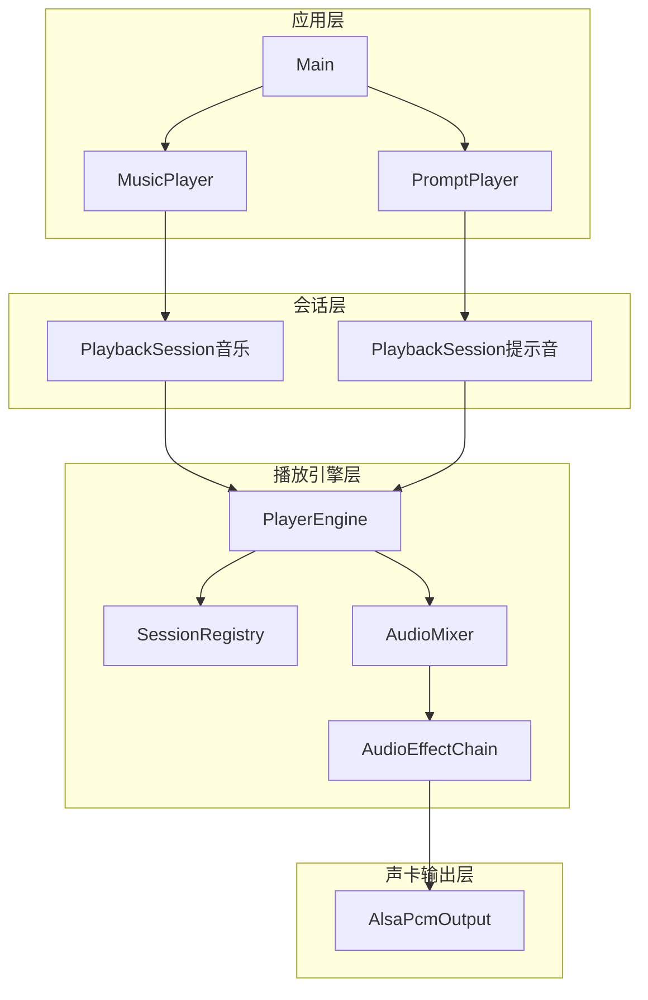

# ALSA 文件与提示音播放

> 从 PCM S16LE WAV 文件播放音乐，并在运行后延迟播放真实提示音文件。

## 功能简介

本示例分为应用层和播放服务两部分。`Main` 负责信号、参数解析和播放流程编排；`MusicPlayer` 逐块读取音乐 WAV 并完成重采样后推流，`PromptPlayer` 在启动时解码提示音 WAV 并在延迟后提交；两个播放器各持一个 `PlaybackSession`，混音后输出到同一个 ALSA playback 设备。

与裸 ALSA 示例相比，本模块提供多会话隔离、队列容量控制、停止唤醒和统计信息。与 GStreamer、PipeWire 或 MediaMTX 相比，它保留对 ALSA 设备和 PCM 参数的直接控制，适合树莓派上的板级播放、提示音和多业务音频共享。

## 软件架构



- 应用层：`Main` 编排流程，`MusicPlayer` 推音乐流，`PromptPlayer` 推提示音流。
- 会话层：每个播放器持有独立 `PlaybackSession`，对外提供 `Open`、`Write`、`Close`。
- 播放引擎层：`PlayerEngine` 持有会话表、混音器和效果链；存在会话时打开声卡并启动混音线程，无会话时关闭声卡并停止线程。
- 声卡输出层：`AlsaPcmOutput` 封装 ALSA 设备打开、写入和关闭。

## 依赖 / 环境

- 硬件：树莓派 5 + WM8960 Audio HAT、USB 声卡或其它 ALSA playback 设备
- 系统：Raspberry Pi OS Bookworm 64-bit
- 系统库：`sudo apt install cmake build-essential pkg-config libasound2-dev`
- 音频权限：当前用户需要访问 `/dev/snd/*`，必要时加入 `audio` 组
- 音乐资源：PCM S16LE、单声道或双声道 WAV；默认文件为 `/home/moyuping/work/audio/testAudio/test.wav`
- 提示音资源：PCM S16LE、单声道或双声道 WAV；默认文件为 `/home/moyuping/work/audio/testAudio/sms_alert_hello.wav`

## 构建与运行

```bash
cd cpp/audio/alsa/alsa_playback
chmod +x build_run.sh
./build_run.sh                  # 配置、构建并播放默认 WAV
./build_run.sh build            # 仅构建
./build_run.sh test             # 构建并运行 CTest
./build_run.sh clean            # 清理 build 目录
./build_run.sh rebuild          # 清理后重新配置、构建并运行
NORUN=1 ./build_run.sh build    # 仅构建不运行
BUILD_TYPE=Debug ./build_run.sh build
```

查看设备并播放指定文件：

```bash
./build_run.sh --list-devices
./build_run.sh --device <ALSA设备名> --music-file <WAV路径> --rate 48000 --channels 2
```

## 关键参数 / 配置

| 参数 / 宏 / 环境变量 | 默认值 | 说明 |
| :--- | :--- | :--- |
| `--device` | `plughw:3,0` | ALSA playback 设备名，默认沿用重构前的 USB 声卡 |
| `--rate` | `48000` | 输出采样率；WAV 为 44100 Hz 时在应用层重采样 |
| `--channels` | `2` | 输出声道数 |
| `--music-file` | `/home/moyuping/work/audio/testAudio/test.wav` | 音乐 WAV 文件路径 |
| `--prompt-file` | `/home/moyuping/work/audio/testAudio/sms_alert_hello.wav` | 提示音 WAV 文件路径 |
| `--prompt-delay` | `5` | 提示音相对程序启动的延迟，单位秒 |
| `--push-timeout-ms` | `100` | 队列满时的最大等待时间 |
| `--duration` | `0` | 播放时长上限；`0` 表示播放到 WAV EOF |
| `maxQueueFrames` | `48000` | 每个业务 session 的队列容量 |
| `BUILD_TYPE` | `Release` | CMake 构建类型 |
| `NORUN` | `0` | 设为 `1` 时跳过应用运行 |

## 已知问题 / 注意事项

- WAV 读取器当前只接受 PCM、16 bit、S16LE、1 或 2 声道格式。
- 44100 Hz 到 48000 Hz 使用线性插值；高保真产品可在 `format/` 边界替换为 SpeexDSP 或 soxr。
- 提示音文件在启动时一次性解码为输出格式，音乐开始后 5 秒提交一次，不循环。
- 队列满时音乐和提示音生产者等待容量；超过 `--push-timeout-ms` 会返回错误，不静默丢弃该 block。
- `Stop`、`Close` 和 session 销毁会唤醒等待中的生产者，并返回 `NotRunning`。
- `droppedFrames` 只统计非阻塞 `PushPcm` 的拒绝帧；阻塞提交超时不会伪装成静默丢帧。`recoveryCount` 只统计 ALSA 恢复。
- `hw:` 要求硬件支持协商出的格式；失败时可尝试 `plughw:`。
- 首次测试请降低功放音量，避免提示音和音乐混音时音量过大。

## 参考资料

- [ALSA Library API](https://www.alsa-project.org/wiki/ALSA_Library_API)
- [ALSA PCM Interface](https://www.alsa-project.org/wiki/ALSA_Library_API)
- [RIFF WAVE specification](https://www.mmsp.ece.mcgill.ca/Documents/AudioFormats/WAVE/WAVE.html)

## 文件架构

```text
alsa_playback/
├── app/                       # 播放流程编排、命令行、音乐和提示音播放器
├── service/audio/playback/    # 播放会话、播放引擎与内部实现
│   ├── include/               # PlaybackSession.h
│   └── src/                   # format/player/session/mixer/effect/device/statistics
└── tests/                     # 不依赖真实声卡的单元测试
```
